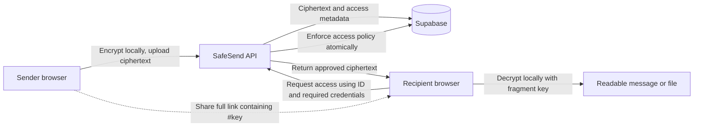

<div align="center">

# SafeSend

### Share a secret. Set the rules.

Browser-encrypted messages and files, with expiring links, access controls, and workspace collaboration.

[Get started](#getting-started) · [How it works](#how-it-works) · [Documentation](#documentation) · [Project status](#project-status)


[](LICENSE)

**Working development build · Production hardening in progress**

</div>

---

SafeSend helps you share sensitive messages and files without leaving a permanently accessible copy on a public link. Encrypt content in your browser, choose its access policy, and share the complete link with your recipient. Manage access through a sender dashboard or collaborate through a workspace.

## Features

| Capability | What is implemented |
| --- | --- |
| **Browser encryption** | AES-256-GCM encryption before upload; local decryption when opening a secret. |
| **Links and QR codes** | Share a complete URL containing the secret ID and a fragment-based decryption key. |
| **Access policies** | Expiration, scheduled availability, view limits, and single-view secrets with atomic database enforcement. |
| **Additional protection** | Optional Argon2-hashed access passwords and confirmed-email recipient restrictions. |
| **Sender controls** | View activity, suspend, resume, and revoke authorized secrets. |
| **Encrypted attachments** | Private storage and encrypted chunk uploads, with same-page retry and resume. |
| **Accounts and workspaces** | Supabase Auth, invitation links, and owner, admin, member, and auditor roles. |
| **Security visibility** | Rule-based threat detection, temporary defenses, and hash-linked audit events. |
| **Activity tools** | Account/workspace analytics, audit export, and persistent in-app notifications. |
| **Developer tools** | Scoped, rotatable API keys, an OpenAPI specification, SDK source, and a CLI. |

Invitations currently use manually shared links. Notification email delivery and passkeys are not enabled. See [project status](#project-status) for other limitations.

## How it works



1. The sender's browser generates an encryption key and encrypts the content.
2. The API stores ciphertext and its access policy in Supabase.
3. The browser builds a share link containing the secret ID and the key after `#`.
4. The recipient opens the link and satisfies any password, account, or time restrictions.
5. The API authorizes access; the recipient's browser decrypts the returned content.

The **decryption key** unlocks the content locally. An optional **access password** is checked by the backend. They serve different purposes.

> [!IMPORTANT]
> A complete share link contains its decryption key. Treat it as sensitive. URL fragments are not sent in ordinary HTTP requests, but anyone who obtains the full link has the key. Access controls cannot erase a copy that a recipient has already saved. Client-side encryption also depends on trusting the frontend code delivered to the browser.

Read the [security architecture](SECURITY_ARCHITECTURE.md) for authorization boundaries, metadata exposure, and audit guarantees. This repository does not claim an independent security audit.

## Architecture

| Layer | Implementation |
| --- | --- |
| Frontend | Next.js 16, React 19, TypeScript, Tailwind CSS 4, Web Crypto API |
| Backend | Node.js, Express 5, TypeScript |
| Database and accounts | Supabase PostgreSQL and Supabase Auth |
| Attachments | Private Supabase Storage, accessed through the backend |
| Integrations | REST API, OpenAPI 3.1, local SDK and CLI |

```text
SafeSend/
├── frontendv2/          Web application, encryption, UI, and frontend tests
├── backend/
│   ├── src/             API routes, authorization, monitoring, and lifecycle logic
│   ├── scripts/         Database inspection, migration, and integration utilities
│   └── openapi.json     API specification
├── supabase/migrations/ Canonical database migration chain
├── sdk/                 TypeScript SDK source and tests
├── cli/                 Command-line client
└── *.md                 Setup, security, API, deployment, and validation guides
```

The backend is the trusted authorization boundary. Application tables use RLS and deny direct browser-role table access; the API uses server-only credentials to enforce account and workspace permissions.

## Getting started

### Requirements

- **Node.js 24** and npm; Node 24 was used for project verification.
- A development Supabase project with the required schema, Auth configuration, and private storage policies.
- Two terminals to run the frontend and backend.

### 1. Clone and install

```bash
git clone https://github.com/AdvayaMishra/SafeSend.git
cd SafeSend
npm ci --prefix backend
npm ci --prefix frontendv2
```

Use the npm lockfiles. The frontend's older pnpm lockfile is historical.

### 2. Configure the environment

Copy these templates using your editor or file manager:

| Template | Local destination |
| --- | --- |
| `backend/.env.example` | `backend/.env` |
| `frontendv2/.env.example` | `frontendv2/.env.local` |

For the frontend:

```dotenv
NEXT_PUBLIC_API_URL=http://localhost:5000
NEXT_PUBLIC_SUPABASE_URL=https://YOUR_PROJECT_REF.supabase.co
NEXT_PUBLIC_SUPABASE_PUBLISHABLE_KEY=YOUR_PUBLIC_PUBLISHABLE_KEY
```

For the backend, set `SUPABASE_URL`, `SUPABASE_SERVICE_ROLE_KEY`, and the exact allowed `FRONTEND_URL`. Configure separate, securely generated values for `EVENT_HMAC_KEY`, `AUDIT_SIGNING_KEY`, and `OPERATIONS_TOKEN`; the backend template lists the remaining settings. Keep stable security keys across restarts.

`DATABASE_URL` and `DATABASE_CA_FILE` support database administration and integration scripts; they are not needed for the API's normal Supabase HTTPS requests. Use verified TLS for database connections.

> [!WARNING]
> Never commit real environment files, database passwords, service-role keys, or signing secrets. Only public frontend configuration belongs in `NEXT_PUBLIC_` variables. The repository includes templates, not working credentials.

### 3. Prepare the development database

Follow [DATABASE_MIGRATIONS.md](DATABASE_MIGRATIONS.md) before running the app. The canonical SQL files are in `supabase/migrations/`; the older files under `backend/supabase/` are historical references.

Fresh projects require the two bootstrap migrations followed by the remaining migrations in order. Existing projects require schema and migration-history reconciliation first. The existing-project migration runner is not a fresh-install bootstrap tool, and its ledger is separate from the Supabase CLI ledger. **Do not blindly run `supabase db push` against an existing database.**

Configure Supabase Auth site/redirect URLs for your local frontend if using account features. Real email confirmation and recovery delivery must be verified for your environment.

### 4. Start the application

In terminal one:

```bash
npm run dev --prefix backend
```

In terminal two:

```bash
npm run dev --prefix frontendv2
```

Open **http://localhost:3000**. The API runs on port **5000**.

| Check | Address |
| --- | --- |
| API health | `http://localhost:5000/api/health` |
| Database connectivity | `http://localhost:5000/api/test-db` |
| OpenAPI specification | `http://localhost:5000/api/openapi.json` |

Anonymous sharing is supported. Its sender-management capability is stored in that tab's session storage; losing it can prevent later anonymous management. Sign in **before creating a secret** for account-based management across devices.

A `localhost` link works on the machine hosting the application. Public sharing requires hosted frontend and backend services, production configuration, and an available Supabase project. GitHub stores the source code; pushing this repository does not deploy those services.

## Development and validation

Run these commands from the repository root:

```bash
npm run build --prefix backend
npm run typecheck --prefix frontendv2
npm test --prefix frontendv2
npm run build --prefix frontendv2
npm test --prefix sdk
```

The SDK build currently uses the TypeScript installation in `backend/node_modules`, so install backend dependencies first. SDK and CLI identifiers retain the earlier SecureShare name for compatibility; neither is published as a public package.

If your local environment cannot start Turbopack workers, the alternative frontend build is:

```bash
npm run build --prefix frontendv2 -- --webpack
```

Integration checks require configured development credentials:

```bash
npm run test:integration --prefix backend
npm run test:authorization --prefix backend
npm run test:migrations --prefix backend
```

These are not all offline unit tests: integration suites create disposable records, and migration rehearsal executes SQL in a transaction that is rolled back. Use a dedicated development/test database. See [TEST_REPORT.md](TEST_REPORT.md) for previously recorded results and unverified scenarios; those results are not a live CI status.

## Documentation

| Guide | Contents |
| --- | --- |
| [Security architecture](SECURITY_ARCHITECTURE.md) | Encryption, access control, metadata, and audit limitations |
| [API reference](API_DOCUMENTATION.md) | Routes, credentials, SDK, and CLI usage |
| [Database migrations](DATABASE_MIGRATIONS.md) | Bootstrap versus existing-project setup, migration history, and recovery |
| [Deployment guide](DEPLOYMENT_GUIDE.md) | Hosting configuration, secrets, operations, and release gates |
| [Test report](TEST_REPORT.md) | Recorded checks, coverage, and unverified areas |
| [Integration progress](INTEGRATION_PROGRESS.md) | Historical implementation details and handoff notes |
| [Contributing](CONTRIBUTING.md) | Local workflow and useful bug reports |
| [Security reporting](SECURITY.md) | Reporting vulnerabilities without exposing sensitive data |

Historical frontend expansion reports describe earlier stages. Use this README and the root architecture, API, migration, and deployment guides for the current implementation.

## Project status

The core application was exercised against a development Supabase project. It is **not yet a production-ready release**.

Remaining work includes:

- Passkey activation and physical-device testing.
- Real signup confirmation and password-reset email verification.
- Independent, durable audit checkpoint storage; current checkpoints are local to the backend.
- Complete pagination and load testing for larger accounts.
- External monitoring, alerting, backup validation, and retention scheduling.
- Camera QR scanning and cross-browser file-save verification.
- Production deployment, Auth redirects, and deployment-specific testing.

Audit chains are tamper-evident within their documented trust model. They do not establish independent integrity if an attacker controls both the database and the signing environment. Upload resume is limited to the current page session; list endpoints have documented result caps.

## Contributing

Bug reports and focused improvements are welcome. Read [CONTRIBUTING.md](CONTRIBUTING.md), and keep credentials and real shared content out of issues, screenshots, and pull requests. For vulnerabilities, follow [SECURITY.md](SECURITY.md).

## License

[MIT](LICENSE) · Copyright © 2026 Advaya Mishra.
