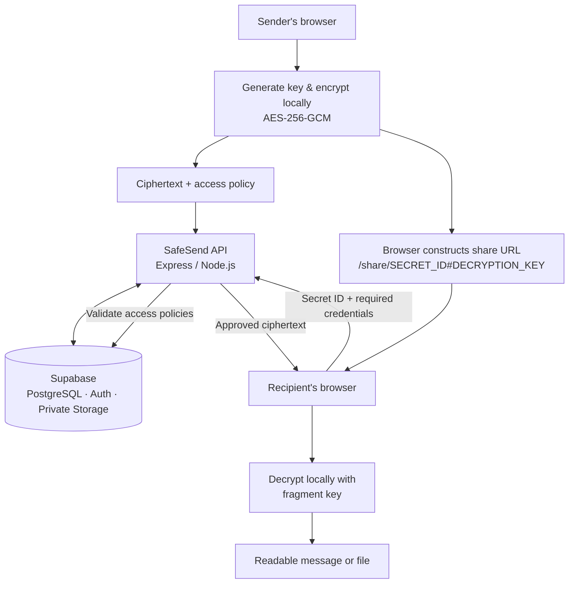

<div align="center">

# 🔐 SafeSend

### Private by design. Shared on your terms.

**Encrypted messages and files, time-limited links, precise access controls, and security visibility — in one full-stack platform.**

[**Live Demo ↗**](https://safesend-three.vercel.app) &nbsp;·&nbsp; [Features](#-features) &nbsp;·&nbsp; [How It Works](#-how-it-works) &nbsp;·&nbsp; [Get Started](#-getting-started) &nbsp;·&nbsp; [Documentation](#-documentation)

[](https://nextjs.org/) [](https://react.dev/) [](https://www.typescriptlang.org/) [](https://nodejs.org/) [](https://supabase.com/) [](LICENSE)

**Public development demo** · Core sharing flows tested · Production hardening ongoing

</div>

---

## Overview

Sharing a password, confidential note, or sensitive document shouldn't require leaving a permanent, uncontrolled copy in somebody's inbox.

**SafeSend** encrypts content in the sender's browser, stores the ciphertext, and lets recipients decrypt it through a link — **only after the backend approves the configured access rules**. Set an expiration, require a password, limit the number of views, restrict access to a verified recipient, or revoke access altogether.

It also includes **accounts, workspaces, role-based permissions, threat detection, audit trails, analytics, and developer APIs**. Anonymous sharing works without signing up; accounts add persistent management and collaboration.

> **Try it:** [safesend-three.vercel.app](https://safesend-three.vercel.app)  
> The API is hosted separately on Render's free tier. After inactivity, the first request may take **around a minute** while the service wakes up.

## ✨ Features

| Area | Capabilities |
|---|---|
| **Encrypted sharing** | Browser-side AES-256-GCM encryption, local decryption, full-link sharing, QR-code generation |
| **Access policies** | Expiration, scheduled access windows, maximum views, single-view/burn-after-read, suspension, revocation |
| **Additional verification** | Optional Argon2-protected access passwords, attempt cooldowns, verified-recipient restrictions |
| **Encrypted files** | Private storage, files up to **25 MB**, authenticated chunk uploads, same-page retry/cancel/resume |
| **Identity & teams** | Supabase Auth, account management, workspaces, invitations, owner/admin/member/auditor roles |
| **Security operations** | Rule-based threat detection, rate counters, temporary defenses, hash-linked audit events |
| **Insights** | Activity history, analytics, audit exports, persistent in-app notifications |
| **Developer platform** | REST API, OpenAPI 3.1, scoped/rotatable API keys, TypeScript SDK source, CLI source |

<details>
<summary><strong>What does “burn-after-read” mean?</strong></summary>

A single-view secret permits only one successful access. The backend consumes the view allowance atomically in PostgreSQL so concurrent requests cannot exceed that limit. It **cannot** prevent a recipient from copying content they have already decrypted.

</details>

## 🔄 How It Works



1. **Create:** The sender writes a message or attaches files and chooses access restrictions.
2. **Encrypt:** The sender's browser generates a key and encrypts the content **before uploading**.
3. **Store:** The API receives ciphertext and policy metadata; Supabase stores the encrypted payload and related records.
4. **Share:** The **browser** constructs a URL such as `https://YOUR_FRONTEND/share/SECRET_ID#DECRYPTION_KEY`.
5. **Authorize:** The recipient requests access using the secret ID and any required password or account session. The backend enforces the policy.
6. **Decrypt:** Once approved, the recipient's browser decrypts the ciphertext using the key in the URL fragment.

**Why the `#` matters:** URL fragments are not sent in ordinary HTTP requests. The decryption key stays in the browser's fragment-handling flow, rather than being supplied to the API. An optional **access password** is different: it is sent over HTTPS to the backend, checked there, and stored as an Argon2 hash.

## 🏗️ Architecture & Stack

| Layer | Technologies |
|---|---|
| **Frontend** | Next.js 16, React 19, TypeScript, Tailwind CSS 4, Web Crypto API, Lucide, QR libraries |
| **Backend** | Node.js 24 (verification environment), Express 5, TypeScript, Argon2, Multer |
| **Data & identity** | Supabase PostgreSQL, Supabase Auth, private Supabase Storage |
| **Deployment** | Vercel (frontend), Render (API) |
| **Integrations** | REST `/api` and `/api/v1` routes, OpenAPI 3.1, TypeScript SDK, CLI |

<details>
<summary><strong>Repository structure</strong></summary>

```text
SafeSend/
├── frontendv2/             # Next.js app, components, crypto, tests
│   ├── app/
│   ├── components/
│   ├── lib/
│   ├── tests/
│   └── .env.example
├── backend/                # Express API and security logic
│   ├── src/
│   ├── scripts/
│   ├── supabase/           # Historical migrations (not canonical)
│   ├── openapi.json
│   └── .env.example
├── supabase/migrations/    # Canonical SQL migration sequence
├── sdk/                    # TypeScript SDK source
├── cli/                    # CLI source
├── render.yaml
├── README.md
└── LICENSE
```

Some internal identifiers still use **SecureShare** for compatibility (including `SecureShareClient`, `@secureshare/sdk`, `SECURESHARE_*`, and the `secureshare_private` database schema). The SDK and CLI are **source components, not published packages**.

</details>

## 🔐 Security Model & Limitations

SafeSend separates **content confidentiality** (browser-side encryption) from **access authorization** (backend policy enforcement).

| Protection | Implementation / boundary |
|---|---|
| Content encryption | AES-256-GCM in the browser before upload |
| Password checks | Argon2 hashes, cooldowns, server-side enforcement |
| View limits | Atomic PostgreSQL access consumption |
| Recipient restrictions | Matching confirmed-email account session |
| Database & storage | RLS-protected application data, private file bucket, backend authorization |
| Audit integrity | Append-only hash-linked records and local backend-HMAC checkpoints |
| API credentials | Scoped keys with rotation, revocation, and usage records |

> [!IMPORTANT]
> **Understand the trust boundaries.** A complete share link contains a decryption key, so treat it as sensitive. The backend still handles metadata and policies; SafeSend is **not metadata-free**. Client-side encryption depends on trusting the frontend code delivered to the browser. Revoking access cannot erase plaintext a recipient already saved. Hash-linked logs are **tamper-evident within their trust model**, not independently tamper-proof; local audit checkpoints are not an independent anchor if both the database and signing environment are compromised.

See [Security Architecture](SECURITY_ARCHITECTURE.md) and [Security Policy](SECURITY.md). This project does **not** claim an independent security audit or absolute security.

## 🚀 Getting Started

### Option A — Use the hosted demo

Open **[SafeSend Live Demo ↗](https://safesend-three.vercel.app)**. Create a secret, copy the **complete** sharing link, and open it in another browser or device. An account is optional for basic sharing; sign in before creating secrets if you want account-based management across devices.

The live site is a **development demo**. A GitHub push alone does **not** update it: Vercel's GitHub auto-deploy connection is not established, and Render auto-deploy is disabled.

### Option B — Run locally

**Requirements:** Node.js **24**, npm, and a development Supabase project configured with the required schema, Auth settings, and private storage policies.

**1. Clone and install**

```bash
git clone https://github.com/AdvayaMishra/SafeSend.git
cd SafeSend
npm ci --prefix backend
npm ci --prefix frontendv2
```

**2. Configure environment files**

Copy `backend/.env.example` → `backend/.env` and `frontendv2/.env.example` → `frontendv2/.env.local`.

**Frontend — `frontendv2/.env.local`:**

```dotenv
NEXT_PUBLIC_API_URL=http://localhost:5000
NEXT_PUBLIC_SUPABASE_URL=https://YOUR_PROJECT_REF.supabase.co
NEXT_PUBLIC_SUPABASE_PUBLISHABLE_KEY=YOUR_PUBLIC_PUBLISHABLE_KEY
```

**Backend — `backend/.env`:**

```dotenv
SUPABASE_URL=https://YOUR_PROJECT_REF.supabase.co
SUPABASE_SERVICE_ROLE_KEY=YOUR_SERVER_ONLY_KEY
PORT=5000
FRONTEND_URL=http://localhost:3000
EVENT_HMAC_KEY=YOUR_INDEPENDENT_RANDOM_SECRET
AUDIT_SIGNING_KEY=YOUR_OTHER_INDEPENDENT_RANDOM_SECRET
AUDIT_CHECKPOINT_FILE=.audit-checkpoints.jsonl
OPERATIONS_TOKEN=YOUR_OPERATIONS_SECRET
ENABLE_LIFECYCLE_WORKER=false
TRUST_PROXY_HOPS=0

# Optional: administration and database-backed tests only
DATABASE_URL=
DATABASE_CA_FILE=
```

Generate signing and HMAC secrets securely and **keep them stable across restarts**. The runtime API uses Supabase HTTPS and does not need a PostgreSQL database password; `DATABASE_URL` and `DATABASE_CA_FILE` are for administration/testing tools.

> [!CAUTION]
> Never commit `.env`, `.env.local`, passwords, service-role credentials, signing keys, or tokens. Never place backend secrets in `NEXT_PUBLIC_` variables.

**3. Prepare the database**

Read [DATABASE_MIGRATIONS.md](DATABASE_MIGRATIONS.md) **before running SQL**. The canonical chain lives in `supabase/migrations/` (two fresh-project bootstrap files and eleven subsequent migrations). The custom migration ledger is `secureshare_private.migrations`, **separate from Supabase CLI history**. A repository clone does not provision Supabase automatically. Do **not** blindly run `supabase db push` or apply bootstrap migrations to an existing database.

**4. Start both services — in separate terminals**

```bash
# Terminal 1: API
npm run dev --prefix backend
```

```bash
# Terminal 2: web app
npm run dev --prefix frontendv2
```

Open **http://localhost:3000**. Press **Ctrl+C** in each terminal to stop the services. `localhost` is only accessible on your own computer unless you separately configure network access.

### Build & test

```bash
npm run build --prefix backend
npm run typecheck --prefix frontendv2
npm test --prefix frontendv2
npm run build --prefix frontendv2
npm test --prefix sdk
```

The SDK test/build uses the TypeScript compiler installed in `backend/node_modules`; install backend dependencies first. If the frontend build fails because of local Turbopack workers, try:

```bash
npm run build --prefix frontendv2 -- --webpack
```

**Database-backed checks (development/test database only):**

```bash
npm run test:integration --prefix backend
npm run test:authorization --prefix backend
npm run test:migrations --prefix backend
```

These are **not offline tests**. Integration tests create disposable fixtures; migration rehearsal executes SQL transactionally and rolls it back. Never run them against an unapproved production database.

### Useful API endpoints

| Endpoint | Local | Hosted |
|---|---|---|
| API health | [`/api/health`](http://localhost:5000/api/health) | [Health ↗](https://safesend-api-62wd.onrender.com/api/health) |
| Database connectivity | [`/api/test-db`](http://localhost:5000/api/test-db) | [DB check ↗](https://safesend-api-62wd.onrender.com/api/test-db) |
| OpenAPI spec | [`/api/openapi.json`](http://localhost:5000/api/openapi.json) | [OpenAPI ↗](https://safesend-api-62wd.onrender.com/api/openapi.json) |

Operational metrics require a private operations token and are not public endpoints.

## 🌐 Deployment & Current Status

| Service | Hosting | Status / notes |
|---|---|---|
| [Web app ↗](https://safesend-three.vercel.app) | Vercel Hobby | Public development frontend |
| [API ↗](https://safesend-api-62wd.onrender.com/api/health) | Render Free · Singapore | Sleeps after ~15 minutes idle; cold starts may take ~1 minute |
| Database, Auth & files | Supabase | Existing development project |

**As of October 21, 2026:** the frontend and backend were deployed and connected to Supabase. Recorded hosted checks covered asset loading, API/database connectivity, CORS restrictions, encrypted message creation and SDK decryption, access-password enforcement, revocation, encrypted chunk upload and retrieval, tamper rejection, burn-after-read delivery, and private storage restrictions. These were **API, asset, and integration checks**, not a complete manual device/browser acceptance test.

Render's free local filesystem is **ephemeral**: local audit checkpoint history can disappear on sleep, restart, or redeploy. Supabase database records and encrypted storage objects are separate from that filesystem. No paid-tier upgrades are implied.

For deployment steps, see [Deployment Guide](DEPLOYMENT_GUIDE.md) and [Demo Deployment](DEMO_DEPLOYMENT.md).

## Project Status

The core application was exercised against a development Supabase project. It is **not yet a production-ready release**.

Remaining work includes:

- Passkey activation and physical-device testing.
- Real signup confirmation and password-reset email verification.
- Independent, durable audit checkpoint storage; current checkpoints are local to the backend.
- Complete pagination and load testing for larger accounts.
- External monitoring, alerting, backup validation, and retention scheduling.
- Camera QR scanning and cross-browser file-save verification.
- Production deployment, Auth redirects, and deployment-specific testing.

## 📚 Documentation

| Guide | Description |
|---|---|
| [Security Architecture](SECURITY_ARCHITECTURE.md) | Cryptography, authorization, trust boundaries, limitations |
| [API Documentation](API_DOCUMENTATION.md) | API usage and integrations |
| [Database Migrations](DATABASE_MIGRATIONS.md) | Canonical SQL sequence and safe migration workflow |
| [Deployment Guide](DEPLOYMENT_GUIDE.md) | Deployment configuration and production requirements |
| [Demo Deployment](DEMO_DEPLOYMENT.md) | Current public demo and deployment details |
| [Test Report](TEST_REPORT.md) | Recorded development tests and remaining validation |
| [Integration Progress](INTEGRATION_PROGRESS.md) | Development milestones and implementation status |
| [Contributing](CONTRIBUTING.md) | Contribution guidelines |
| [Security Policy](SECURITY.md) | Responsible vulnerability reporting |
| [License](LICENSE) | MIT terms |

## 🤝 Contributing

Suggestions, bug reports, and improvements are welcome. See [CONTRIBUTING.md](CONTRIBUTING.md). Please **do not post real credentials, share links, or sensitive user data** in public issues. Report security vulnerabilities privately as described in [SECURITY.md](SECURITY.md).

## 📄 License & Author

Licensed under the **[MIT License](LICENSE)**.  
Copyright © **2026 Advaya Mishra**.

<div align="center">

---

**SafeSend** · [Live Demo](https://safesend-three.vercel.app) · [Source Code](https://github.com/AdvayaMishra/SafeSend)

*Share what matters. Keep control of who can see it.*

</div>
